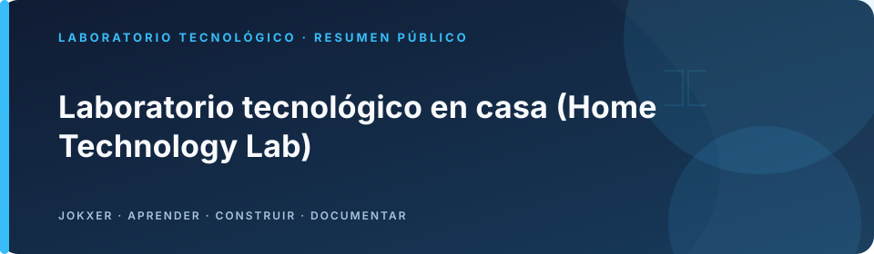

<h1 align="center"></h1>

### Aprender · experimentar · construir servicios propios

**Un recorrido práctico por almacenamiento privado, infraestructura y servicios autohospedados.**

[🧭 Visión](#visión) · [🧰 Líneas de trabajo](#líneas-de-trabajo) · [🗺️ Ruta](#ruta-general) · [🔒 Privacidad](#privacidad-del-proyecto)

## Visión

Este laboratorio explora cómo construir, administrar y proteger servicios tecnológicos en un entorno doméstico. El objetivo es aprender mediante proyectos graduales, documentar decisiones y convertir ideas en pruebas reproducibles, usando equipos reutilizados y herramientas gratuitas.

## Líneas de trabajo

| Línea | Objetivo |
| --- | --- |
| 💾 Almacenamiento privado | Organizar archivos y probar copias recuperables |
| ☁️ Sincronización | Acceder a documentos entre dispositivos propios |
| 🌐 Servicios web | Experimentar con aplicaciones y sitios de prueba |
| 🧱 Aislamiento | Separar servicios y permisos según su función |
| 🎮 Juegos y cómputo | Explorar servidores y cargas de trabajo |
| 🛡️ Operación segura | Practicar acceso privado, monitoreo y recuperación |

## Estado al 23 de noviembre de 2026

El equipo NAS reutilizado opera con Debian 13. Tiene servicios de archivos SMB/NFS, nube local, Docker, acceso SSH y alojamiento de páginas web sencillas. La conexión Ethernet y el acceso remoto mediante Tailscale fueron probados; el inicio automático del cliente Tailscale en Windows sigue pendiente.

| Estado | Descripción |
| --- | --- |
| 🟢 Operativo | Sistema base, administración SSH, archivos de red y servicios iniciales |
| 🟡 En validación | Recuperación de respaldos y permisos desde los clientes |
| ⚪ En preparación | Automatización del acceso remoto y documentación de copias |
| ⚪ Planificado | Snapshots, monitoreo, proxy inverso y máquinas virtuales según recursos |

La prioridad inmediata es validar una restauración antes de depender del disco externo de respaldo. El detalle de la distribución de almacenamiento permanece en el repositorio privado.

## Ruta general

1. Validar copias mediante una restauración real.
2. Comprobar permisos de acceso desde los dispositivos cliente.
3. Completar el acceso remoto cotidiano.
4. Añadir servicios gradualmente y documentar sus límites.

## Privacidad del proyecto

Esta página presenta el proyecto a grandes rasgos. El inventario detallado, decisiones de red, procedimientos operativos y configuración interna permanecen en un repositorio privado. No se publican direcciones de red, identificadores de equipos, credenciales ni llaves. Los servicios planificados todavía no están desplegados.