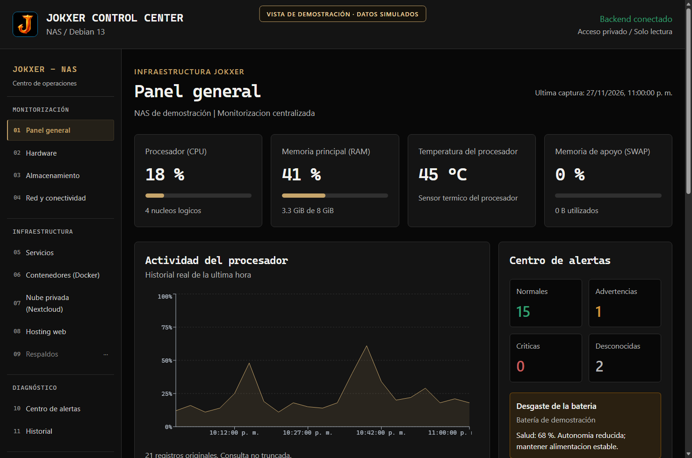
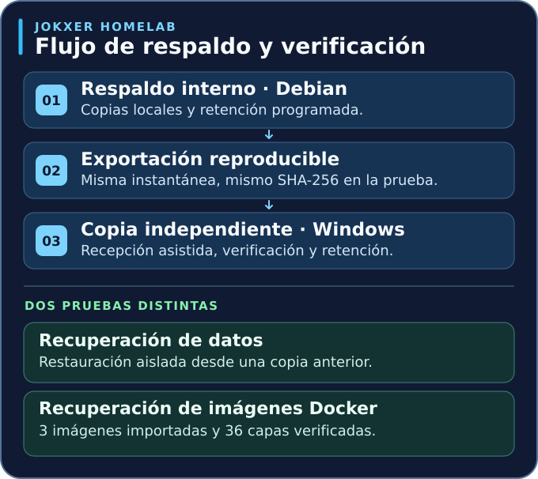

<h1 align="center"></h1>

### NAS, nube privada y recuperación de datos

Nube privada recuperable y un centro de control para entender qué funciona, qué requiere atención y cuándo se midió.

[📊 Aplicativo](control-center.md#vista-del-aplicativo) · [✅ Resultados](#resultados-verificables) · [🧰 Infraestructura](infraestructura.md) · [💾 Respaldos](resultados-de-respaldo.md) · [🌐 Hosting](hosting-web.md) · [🗺️ Plan Maestro](PLAN-MAESTRO.md) · [🎓 En palabras simples](EN-PALABRAS-SIMPLES.md)

## El proyecto

Convertí una laptop reutilizada con Debian en un NAS doméstico con nube privada, contenedores, acceso remoto privado y copias recuperables. Después construí un panel para consultar el estado del sistema en un solo lugar y saber cuándo falta evidencia antes de actuar.

| Frente | Estado comprobado | Qué falta |
|---|---|---|
| **NAS y nube privada** | Nextcloud, Docker y acceso privado verificados. | Completar validaciones de permisos de clientes SMB/NFS. |
| **Respaldos** | Restauración aislada y primer disparo diario de Nextcloud comprobados. | Verificar los ciclos de hosting, exportación semanal y recepción externa por separado. |
| **Control Center** | **11 vistas iniciales** en desarrollo; explorador histórico y diagnóstico avanzado incorporados. | Completar validaciones y desplegar por HTTPS privado. |
| **Hosting** | Sitio de muestra recuperado y primera portada pública provisional publicada. | Verificar la recuperación específica del portal y sustituir la página privada de prueba por el aplicativo. |

## Control Center

**Corte del aplicativo: 27 de noviembre de 2026, 22:52 AST.** El panel permite explorar tendencias históricas y consultar hardware, almacenamiento, red y respaldos sin modificar servicios. La API de lectura respondió en Debian y el frontend compiló en Windows. Todavía no se ha desplegado en su destino privado definitivo.

*Captura de la interfaz real con datos simulados.* [Ver capturas, alcance y próximos hitos](control-center.md#vista-del-aplicativo).

## Resultados verificables

**Operación y recuperación · 26 de noviembre de 2026.** El primer respaldo diario de Nextcloud tras los ajustes se ejecutó automáticamente. En hosting, verifiqué una recuperación de muestra, una copia independiente recibida en Windows y la salida HTTPS de la primera portada de terceros. [Ver portada provisional](https://mukien.jokxer.dev/).

| Hito | Resultado comprobado | Alcance |
|---|---|---|
| Recuperación desde copia independiente | **142 archivos en 24 carpetas**, sin errores de escaneo; descarga, escritura y eliminación autenticadas | Entorno aislado y archivo de control; no se verificó cada archivo individualmente |
| Protección de dependencias Docker | **3 de 3 imágenes** respaldadas e importadas; **36 de 36 capas únicas** verificadas con SHA-256 | Importación en el host existente, no recuperación desde cero |
| Respaldo programado | Primer respaldo diario de Nextcloud validado tras los ajustes; tarea de Windows ensayada de forma asistida | Faltan los disparos programados del hosting y las exportaciones semanales |

[Ver las pruebas de respaldo y sus límites](resultados-de-respaldo.md).

## Infraestructura desplegada

Debian concentra almacenamiento, Nextcloud, Docker, respaldos y hosting ligero. AnduinOS está reservado para juegos, virtualización, IA y multimedia; esa asignación no significa que todo esté instalado. [Ver arquitectura, servicios y decisiones](infraestructura.md#infraestructura-desplegada).

## Catálogo de servicios

[Consultar las 16 iniciativas y su estado](infraestructura.md#catálogo-de-servicios). Se distingue entre servicio en operación, piloto y trabajo planificado.

## Avances que ya se realizaron

[Consultar los hitos de instalación, sincronización, recuperación y hosting](infraestructura.md#avances-que-ya-se-realizaron).

## Cómo verifico los respaldos

1. **Debian:** genera las copias internas y aplica la retención.
2. **Exportación:** al regenerar la misma instantánea en la prueba, el archivo conservó su SHA-256.
3. **Windows:** recibe la copia con autenticación asistida, verifica su integridad y aplica la retención.

**Pruebas por separado:** la restauración de datos se hizo en un entorno aislado con una copia anterior. Las tres imágenes Docker se importaron en el host existente y se verificaron 36 capas. [Ver resultados y límites](resultados-de-respaldo.md).

## Decisiones de seguridad y estabilidad

[Ver las decisiones y límites de publicación](infraestructura.md#decisiones-de-seguridad-y-estabilidad). El panel y Nextcloud son privados; la publicación externa de la portada provisional del portal es independiente.

## Siguiente etapa

- **Control Center:** completar diagnósticos pendientes, validar el acceso HTTPS por LAN/Tailscale y comprobar que no sea accesible desde Internet. Reemplazar la página privada de prueba solo tras esas pruebas y verificar la automonitorización.
- **Continuidad:** registrar cada disparo automático y la recepción de su copia por separado. Ensayar restauración desde el formato reproducible y medir el tiempo de recuperación.

## Documentación y alcance

[Plan Maestro](PLAN-MAESTRO.md) · [Caso del portal](https://github.com/jokxer8/Portal-Mukien-Sang-Ben-Overview) · [Perfil de Jokxer8](https://github.com/jokxer8#homelab-y-nas). No se publican rutas, direcciones, registros internos ni secretos.
