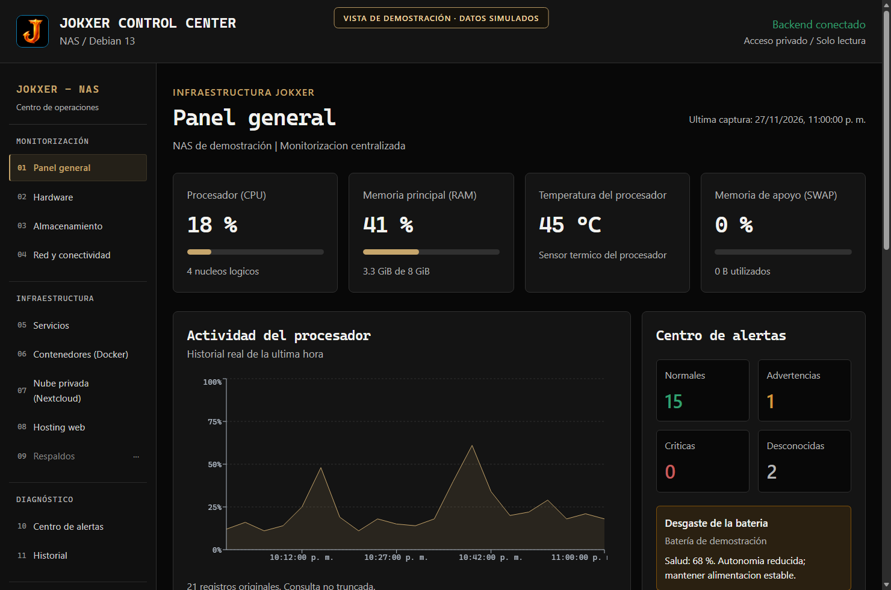
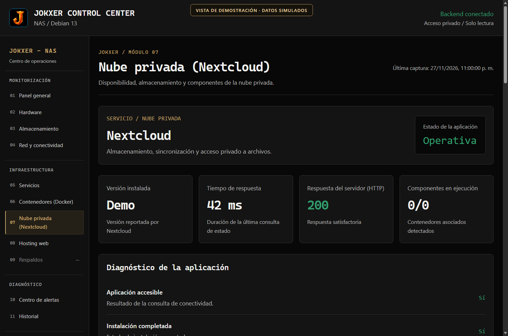

# Jokxer NAS Control Center

[Inicio](README.md) · [Plan Maestro](PLAN-MAESTRO.md) · [Respaldos](resultados-de-respaldo.md) · [Hosting](hosting-web.md)

**Corte:** 27 de noviembre de 2026, 21:31 AST. **Estado:** interfaz de desarrollo y API privada comprobadas por separado; despliegue privado definitivo pendiente.

## Vista del aplicativo

*Captura de la interfaz real, ejecutada en un entorno local con respuestas simuladas. La curva y los valores no son telemetría del NAS.*

| Vista | Qué responde | Qué se comprobó |
|---|---|---|
| Panel general | ¿Qué merece atención ahora? | La interfaz reúne recursos, tendencia de CPU, alertas y hora de consulta. En la demostración se reprodujo la navegación y la carga de los indicadores. |
| Nube privada (Nextcloud) | ¿Responde la nube? ¿Qué puedo revisar sin entrar a administrarla? | La interfaz muestra estado y tiempo de respuesta. La API privada también devolvió el inventario administrativo previsto sin correos, directorios de usuario, contraseñas ni tokens en la respuesta comprobada. |
| Histórico | ¿Hubo un pico o se mantiene en el tiempo? | En la prueba del NAS respondieron las consultas de estado, alertas y serie de CPU. El motor registró siete ciclos en ese corte sin errores de captura, alertas ni mantenimiento. No es una prueba de operación sostenida. |

*La segunda captura también usa datos simulados. Ninguna imagen contiene cuentas, rutas ni direcciones del NAS real.*

## Qué problema resuelve

Quiero saber si el NAS funciona, qué requiere atención y cuándo se comprobó. La interfaz debe emplear nombres claros en español con el término técnico entre paréntesis cuando ayude, y explicar qué significa cada indicador, qué riesgo implica y qué conviene revisar. Sin una lectura reciente no se puede concluir que un equipo esté sano ni que esté averiado. Por ejemplo, un disco externo puede estar montado y funcionando aunque su adaptador no entregue datos de salud (SMART); el panel debe mostrar ese diagnóstico como **no evaluado**, no como fallo.

## Evidencia y alcance

| Suite | Comprobaciones superadas | Qué quedó probado |
|---|---:|---|
| Contrato permanente de inventarios | **75** | Se distingue si una fuente está disponible y si su inventario es completo y confiable. Un inventario inválido, incompleto o sin verificar no permite inferir ausencias. Se comprobó la integridad de la base de prueba y que sus referencias permanecieran válidas. |
| Seguimiento adaptativo permanente | **133** | Solo se suma evidencia con mediciones nuevas: no duplicados, datos en caché ni lecturas vencidas. Una interrupción o un salto temporal invalida la continuidad; si el elemento reaparece, se limpia la evidencia acumulada. Se probaron reversión de cambios, aislamiento entre operaciones simultáneas e integridad referencial. |
| Ciclo integrado | **20** | Se probaron once fuentes; se mantuvieron deshabilitadas la certificación y la retirada por inventario vacío. Se conservaron el esquema y sus 41 reglas automáticas (disparadores de la base). |
| Capacidad del ciclo integrado | **19** | Se persistieron 2.000 identidades sintéticas y se ejecutaron seis ciclos. El más lento tardó 191 ms; se observaron 23,35 MiB de memoria pico del proceso y 772 KiB de almacenamiento final de prueba. La retirada permaneció deshabilitada. |

Los escenarios de seguimiento cubrieron categorías de sistema, red, hardware, servicios, almacenamiento, Nextcloud, hosting, Docker, salud de discos, volúmenes lógicos y respaldos. Las suites se ejecutaron por separado en un laboratorio temporal; **los recuentos no se suman como cobertura única, no equivalen a sensores activos y no miden disponibilidad del NAS**. Una ejecución inicial se detuvo al usar una medición de prueba vencida; la ejecución final completó la suite e incluyó el rechazo de lecturas caducadas entre los casos válidos.

### Prueba de historiales representativos

Otra suite, de **18 comprobaciones**, ensayó con 219 identidades sintéticas, 78 reglas de clasificación y cinco clases de métricas. Las 21.420 mediciones quedaron representadas en 2.628 resúmenes de cinco minutos y luego en 219 resúmenes horarios, preservando el conteo de muestras por clase. La ejecución final superó el problema de presupuesto del ensayo anterior para esa carga modelada y registró una memoria pico de 33,56 MiB. No fue una prueba de producción ni una garantía para otros volúmenes.

Los números de capacidad del ciclo integrado corresponden a seis ciclos sobre datos sintéticos; no son un compromiso de rendimiento, un límite recomendado ni una proyección de almacenamiento real.

Estas pruebas se hicieron antes de la validación de la API y no demuestran operación sostenida ni permiten tratar como telemetría real todo el histórico disponible. Nextcloud, el hosting y los respaldos existentes se validan por separado y no dependen de este panel.

## Primera versión visible

La interfaz disponible en desarrollo usa React, TypeScript y Vite; presenta un menú lateral por áreas, tarjetas de estado y una gráfica de CPU con Recharts. Consulta una API FastAPI de solo lectura; en el NAS se observó el motor SQLite en ejecución durante una comprobación puntual. La vista de alojamiento todavía puede mostrar una página de prueba: no acredita que el panel ya esté servido en su destino final.

**Siguiente hito:** servir la interfaz por HTTPS desde la red privada autorizada, comprobar que la API y el frontend no respondan desde Internet y cotejar estados normales, fallos confirmados y datos no evaluados. Después, validar operación sostenida y el indicador de último respaldo verificado. El portal externo y las copias del NAS se validan por separado.

No se publican endpoints privados, configuraciones internas ni registros sin depurar.
